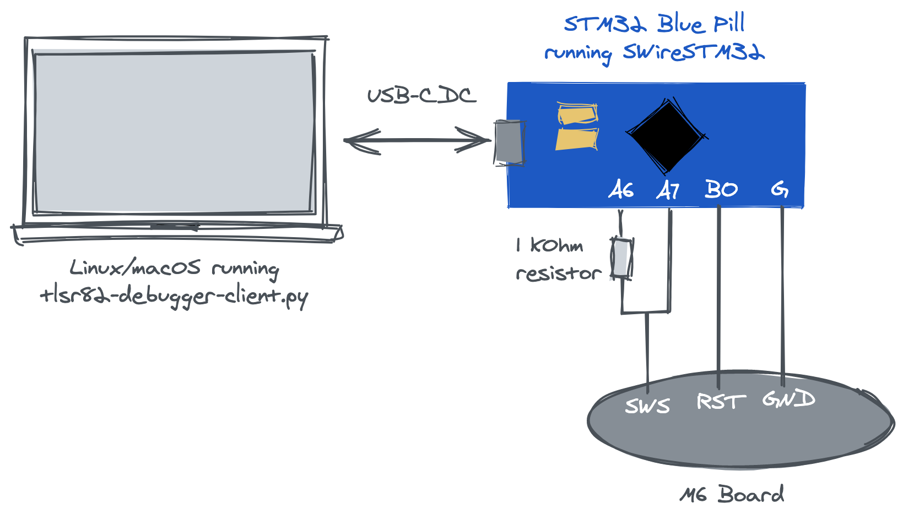

# SWire Interface

## Overview

The SWire programmer is Rust end to end. `probe-pico` is RP2040 firmware that drives the TLSR8266 single-wire interface from PIO with a self-syncing bit-level implementation, and `probe-tlsr` is the host CLI that talks to it over USB CDC. Together they cover flashing, memory access, RTT logs, crash inspection and hardware breakpoints. Both are compiled Rust: flashing a device needs no scripting runtime on the host.

The protocol was reverse-engineered by Raphael Baron ([rbaron/m6-reveng](https://github.com/rbaron/m6-reveng); see also the [blog post](https://rbaron.net/blog/2021/07/06/Reverse-engineering-the-M6-smart-fitness-band.html)), and this repository adapts his client to an RP2040 probe.

## Prerequisites

- A Raspberry Pi Pico or Pico W.
- Rust. The probe workspace pins its own compiler in [`tools/probe/rust-toolchain.toml`](../tools/probe/rust-toolchain.toml), which also installs the `thumbv6m-none-eabi` target; `probe-pico` needs rustc 1.93 or newer. Run `rustup show` in `tools/probe` to fetch it. This is separate from the `rust/` firmware toolchain.
- A UF2 converter, `picotool` or `elf2uf2-rs`. On Linux, install the lighter one with `cargo install elf2uf2-rs --locked --no-default-features`; the flag avoids the `libudev` dependency, which only the unused deploy path needs.
- Serial access to the probe's CDC port. Either add yourself to `dialout` (`sudo usermod -aG dialout "$USER"`, then log out and back in) or drop a udev rule in `/etc/udev/rules.d/99-tlsr-probe.rules`: `SUBSYSTEM=="tty", ATTRS{idVendor}=="2e8a", ATTRS{idProduct}=="000a", GROUP="dialout", MODE="0660"`.

## One-Time Probe Install

Build the probe firmware and its `.uf2` with `tools/probe/build-pico.sh`. The script builds `probe-pico` for `thumbv6m-none-eabi`, converts the ELF with `picotool` or `elf2uf2-rs`, then prints the path of `tools/probe/target/thumbv6m-none-eabi/release/probe-pico.uf2` and the flashing hint. If no converter is on `PATH` it exits 2 with the install line above.

```bash
tools/probe/build-pico.sh
```

Then flash the Pico:

1. Hold **BOOTSEL** and plug the Pico in; it mounts as a `RPI-RP2` volume.
2. Copy `probe-pico.uf2` onto that volume. The Pico reboots into the probe firmware and the volume disappears.

The host side is the `probe-tlsr` binary, which comes from this repository. Build it once and put it on `PATH`:

```bash
cd tools/probe
cargo build --release -p probe-tlsr
export PATH="$PWD/target/release:$PATH"    # or copy it somewhere already on PATH
```

Every command in this guide is written as `probe-tlsr …`; from a checkout without it on `PATH`, prefix each one with `cargo run -q -p probe-tlsr --`.

Verify that the probe enumerates and answers:

```bash
lsusb | grep 2e8a
# Bus 001 Device 005: ID 2e8a:000a ... tlsr8266_mesh probe-pico
probe-tlsr info
```

## Hardware Connections

| Signal | Schematic (STM32) | Pico | Notes |
|---|---|---|---|
| Target reset | B0 | GP14 | Probe drives the TLSR8266 reset line |
| SWS RX (target → probe) | A7 | GP15 | Direct connection |
| SWS TX (probe → target) | A6 | GP17 | 1 kΩ series resistor |

The target and the Pico must share ground, and the target must be powered. The 1 kΩ resistor on GP17 is the series protection the schematic puts on the probe's transmit line. Baron's write-up names the single-wire pins `SWDIO` and `SWCLK`; this project calls them SWS TX and SWS RX.



## Crystal Speed

One image runs on both crystal speeds. At boot, `clock_init()` measures the external crystal against the chip's free-running `32K_RC` reference and records whether the part is 12 MHz or 16 MHz; `rf_drv_init()` then loads the matching RF/PLL table — all 61 `TBL_RF_INI` entries on a 16 MHz part, the first 57 on a 12 MHz part. The choice is made at runtime, so there is no feature to enable and no second image to build.

```bash
make                                    # firmware for either crystal speed
make FEATURES=rtt                       # the same firmware with the RTT log mirror
```

`FEATURES` selects optional extras such as the RTT log mirror; the crystal is not part of it.

To confirm what a board carries, read the boot banner from an RTT build: `Booting FW version <n>, xtal: 12MHz` or `Booting FW version <n>, xtal: 16MHz`. Because there is only one image, a board can no longer be given a wrong-speed build: the header word carries the plain build version with bit 31 always clear, so there is nothing for the tooling to compare or override. A device still running an older 16 MHz image has bit 31 set in its header; host tools mask that bit when comparing versions, so the universal image is accepted onto it with no special flags.

## Command Reference

"Core left stopped" means the command leaves the target halted; recovery is `probe-tlsr reset`, or `reset --soft` after a stall.

| Command | What it does | Arguments | Core left stopped |
|---|---|---|---|
| `info` | Reports `pc`, `cpu_status` and `cpu_state`; reads the flash header only when the core is already stopped | `--halt` stalls the core first | Only with `--halt` |
| `flash` | Writes an ELF or flat binary image to flash | `<PATH>`, `--reset` | Yes, unless `--reset` |
| `flash-read` | Reads a flash span; `--out` saves the raw bytes to a file | `<ADDR> <LEN>`, `--out <FILE>` | Yes |
| `flash-erase` | Erases the 4 KiB sectors covering a flash span | `<ADDR> <LEN>` | Yes |
| `flash-write` | Programs a raw file at a flash address; unlike `flash`, it neither flattens an ELF nor erases the target sectors | `<ADDR> <FILE>` | Yes |
| `read` | Reads SWire memory | `<ADDR_OR_SYMBOL> [LEN]` | No |
| `write` | Writes hex bytes to SWire memory | `<ADDR_OR_SYMBOL> <HEX>` | No |
| `analog-read` | Reads one analog register | `<ADDR>` | No |
| `analog-write` | Writes one analog register | `<ADDR> <VAL>` | No |
| `reset` | Resets the target core; `--soft` reboots through SWire | `--soft`, `--stop` | Only with `--stop` |
| `halt` | Stalls the core and disables the watchdog | none | Yes |
| `inspect` | Stalls the core and dumps registers, stacks, reset cause and the panic body | none | Yes |
| `rtt` | Streams the target's RTT log; fails on a panic line or a frozen heartbeat | requires `--elf`; `--until <SUBSTR>`, `--watchdog-ms <MS>` | Only on a fault |
| `trap` | Arms a hardware breakpoint, waits for it, reports and soft-reboots | `<ADDR_OR_SYMBOL>`, `--slot <0..3>` | No (a hit reboots the core) |

Field notes:

- `info` on a running target deliberately sends no MSPI traffic, so it has no JEDEC id or build version. Use `probe-tlsr info --halt` to read the header; that stall is terminal, so finish with `probe-tlsr reset --soft`. The reported `pc` and `cpu_status` are sampled just before the halt, so `cpu_state` can read `running` even though the core is stalled by the time the header is read.
- `cpu_state` names only the documented status bytes (`0x00`/`0x04`/`0x08` running, `0x05` stopped, `0x06` stalled) and prints `unknown` otherwise. Treat `cpu_status` as a raw hardware byte, not a reliable run/stop indicator.
- A hard `reset` clears the retained analog sentinel in hardware; `reset --soft` and a `trap` hit write `0x00` first (a pending panic `0xE1` is preserved), so the next boot does not log a false `[WD_RESET]`. A real watchdog reset still does.
- `rtt` retries poll errors for a 2 s grace period while a panic or watchdog reset reboots the target, so the `[PANIC]` line from the next boot is not lost. The window restarts after any successful poll. If the target's 256-byte ring overflowed before the stream attached, `rtt` prints a `[probe] target RTT ring overflowed …` line first.
- `flash` (without `--reset`), `flash-read`, `flash-erase` and `flash-write` leave the core stopped and disarm the Timer 2 watchdog before touching MSPI, so a multi-second erase/program/read cannot be interrupted by a watchdog reset.
- `read` and `write` accept a symbol name with `--elf`, or an address in a SWire window: `0x0..=0xfff`, `0x8000..=0xbfff`, `0x800000..=0x800fff` or `0x808000..=0x80bfff`. Without `--elf` only numeric addresses work. `read` defaults to the symbol size, else 4 bytes.

Global flags:

| Flag | Meaning |
|---|---|
| `--port <PATH>` | Serial port; auto-detected when omitted (first USB port with vendor ID `0x2e8a`, else `/dev/ttyACM0` if it exists) |
| `--elf <PATH>` | ELF used for symbol lookup; required by `rtt`, optional elsewhere |
| `--json` | Prints one JSON object per command on stdout |
| `--timeout-ms <MS>` | Per-response timeout, default 5000 ms. `rtt` and `trap` also read it as their stream or wait deadline, where absent or `0` means no deadline. |

Exit codes:

| Code | Meaning |
|---|---|
| 0 | Success |
| 1 | Any other failure — transport, protocol, ELF, I/O, invalid address, timeout |
| 2 | Usage error (clap), or `rtt` saw the heartbeat stop moving |
| 3 | `rtt` saw a panic line |

## Workflows

### Build and Flash the Firmware

```bash
make
probe-tlsr flash _build/lightblemesh.bin --reset
```

`flash` accepts the ELF (`_build/lightblemesh`) or the flat binary; it flattens an ELF's loadable segments itself. Without `--reset` the core stays stopped.

For a logging build, add the RTT mirror before flashing:

```bash
make FEATURES=rtt
probe-tlsr flash _build/lightblemesh.bin --reset
```

Both builds write `_build/lightblemesh` and `_build/lightblemesh.bin`, so the RTT image replaces the default one. Run `make` again to restore the default image.

### Stream Logs

```bash
probe-tlsr --elf _build/lightblemesh rtt --until "Booting FW version"
```

`rtt` requires `--elf`: it resolves `_TLSR_RTT` and `HEARTBEAT` from the ELF's `.symtab`, and fails before sending a request without it. The target must run an RTT build (`FEATURES=rtt`); a default image has no ring to stream. `--until` stops at the first matching line and exits 0. Without it the stream runs until interrupted or the `--timeout-ms` deadline.

### Hang Triage

```bash
probe-tlsr --elf _build/lightblemesh rtt --watchdog-ms 1000
```

`rtt` reads `HEARTBEAT` after every poll. If it does not change for `--watchdog-ms` (default 1000), the main loop is assumed stopped: the command writes the stall message and an `inspect` block to stdout, exits 2, and leaves the core stalled. Recover with `probe-tlsr reset --soft`. To exercise the path deliberately, run `probe-tlsr halt` first and then start `rtt`; `halt` disables the watchdog, so the stall persists.

### Crash Triage

```bash
probe-tlsr --elf _build/lightblemesh inspect
probe-tlsr --elf _build/lightblemesh trap irq_handler --timeout-ms 5000
```

`inspect` stops the core, dumps the register block, both stacks, the retained reset cause and the flash panic record at `0x7B000`, and symbolizes what it can from `--elf`. With `--elf` and a `tc32-elf-objdump` on `PATH` it also disassembles a short window around `PC`. The core stays stalled; finish with `reset --soft`.

`trap` arms one of four hardware breakpoint slots and waits for the hit. A hit stops the core terminally, so the command prints the report, clears the slot and soft-reboots the target. Slot 0 is the default; `--slot` takes 0–3. Absent or `0` `--timeout-ms` waits forever; a deadline clears the armed slot before failing, so an orphaned breakpoint cannot re-trap the next boot. The address must execute *after* arming: `irq_handler` and per-loop functions work on a running target, while a boot-only symbol such as `main_entrypoint` simply times out once the device has booted. For a one-shot boot path, arm while the core is stopped and start it yourself: `probe-tlsr reset --stop`, then `trap`, then `probe-tlsr reset`. Prefer stable asm or `extern "C"` symbols (`irq_handler`, `main_entrypoint`) or numeric addresses, because Rust symbols are mangled per build.

## Composable Recipes

### Stack Watermark

The startup code fills free SRAM with `0xffffffff` (the loop labelled `FLL_STK` in `sdk/cstartup_8266.S`, a code label — not an address to read); the main stack grows down from the top of RAM at `0x80c000`, so the deepest word that is no longer `0xffffffff` is the watermark. The bottom of that free region is `_end_bss_`, read from the ELF's symbol table:

```bash
# Peak stack use since boot. Startup fills free SRAM with 0xffffffff
# (the loop labelled FLL_STK in sdk/cstartup_8266.S); the main stack grows
# down from the top of RAM (0x80c000), so the deepest word that is no longer
# 0xffffffff is the watermark. `_end_bss_` is the bottom of that free region.
ELF=_build/lightblemesh
END_BSS=0x$(./toolchain/tc32/bin/tc32-elf-nm "$ELF" | awk '$3=="_end_bss_"{print $1}')
probe-tlsr read "$END_BSS" $((0x80C000 - END_BSS)) --json |
  python3 -c 'import json, sys
d = bytes.fromhex(json.load(sys.stdin)["data_hex"])
base, top = int(sys.argv[1], 16), 0x80C000
words = [int.from_bytes(d[i:i+4], "little") for i in range(0, len(d), 4)]
dirty = [base + 4 * i for i, w in enumerate(words) if w != 0xffffffff]
peak = top - min(dirty) if dirty else 0
print(f"watermark 0x{top - peak:08x}  peak stack {peak} B  headroom {top - base - peak} B")' "$END_BSS"
```

The read covers `_end_bss_..0x80c000` and does not stop the core; the span must stay inside the `0x808000..0x80bfff` SWire window. The static gate (`make stack-check`) reports a conservative worst-case call chain, so the live watermark is normally well below it — on the bench, 1148 B live against a 1656 B static worst case. Treat that as an observation, not a guarantee.

### NVM Backup and Restore

The non-volatile block is six 4 KiB sectors ending just below the application:

| Address | Contents |
|---|---|
| `0x76000` | MAC address |
| `0x77000` | Pairing keys |
| `0x78000` | Luminance |
| `0x79000` | Group address |
| `0x7A000` | Reset counter |
| `0x7B000` | Panic record |

```bash
probe-tlsr flash-read 0x76000 0x6000 --out nvm-backup.bin   # stops the core; 24576 bytes
probe-tlsr flash-erase 0x76000 0x6000
probe-tlsr flash-write 0x76000 nvm-backup.bin
probe-tlsr reset
```

All three flash commands stop the core and leave it stopped, and `flash-erase` erases whole 4 KiB sectors, so the span must be sector-aligned or neighbouring data goes with it. A restore has to finish before `reset`; keep the `reset`, or the device stays dark until the next power cycle. Erasing these sectors removes the MAC and pairing keys, so back up first and check that `nvm-backup.bin` is exactly `0x6000` bytes (24576 bytes) before erasing. `flash-read --out` writes through a sibling `.tmp` file and renames it, so a failed backup cannot truncate an existing one.

## Troubleshooting

| Symptom | Likely cause | Fix |
|---|---|---|
| `transport: no probe found (no USB VID 0x2e8a port and /dev/ttyACM0 missing); pass --port <path>` | No probe firmware, a charge-only cable, or BOOTSEL mode (mounts as `RPI-RP2`, not a serial port) | Reflash `probe-pico.uf2`, use a data cable, or pass `--port /dev/ttyACM0` |
| `transport: cannot open /dev/ttyACM0: Permission denied` | User not in `dialout`, no udev rule | Add the group or the rule from Prerequisites |
| `transport: timed out waiting for a probe response` | Wiring, missing ground, unpowered target, missing 1 kΩ resistor | Check GP14/GP15/GP17, ground and target power, then retry `probe-tlsr info` |
| `probe error: ...` | The probe rejected the request, e.g. a span outside the requested window | Re-read the argument forms in the command reference |
| Core stuck after a crash command | `halt`, `inspect`, `info --halt`, a faulted `rtt` or `flash` without `--reset` left it stopped | `probe-tlsr reset --soft` for a stall, `probe-tlsr reset` for a hard reset |
| Exit 2 from `rtt` | Frozen heartbeat, or a clap usage error | Triage as in Hang triage; check flags on a usage error |
| Exit 3 | Panic line on the log | Use `inspect` for the panic body |

## CI

The `probe` job in `.github/workflows/ci.yml` checks formatting, clippy and unit tests for `tools/probe`, and cross-builds `probe-pico` for `thumbv6m-none-eabi`. It has no probe and no target attached, so it cannot verify SWire timing, wiring or any workflow on this page — those need hardware.
